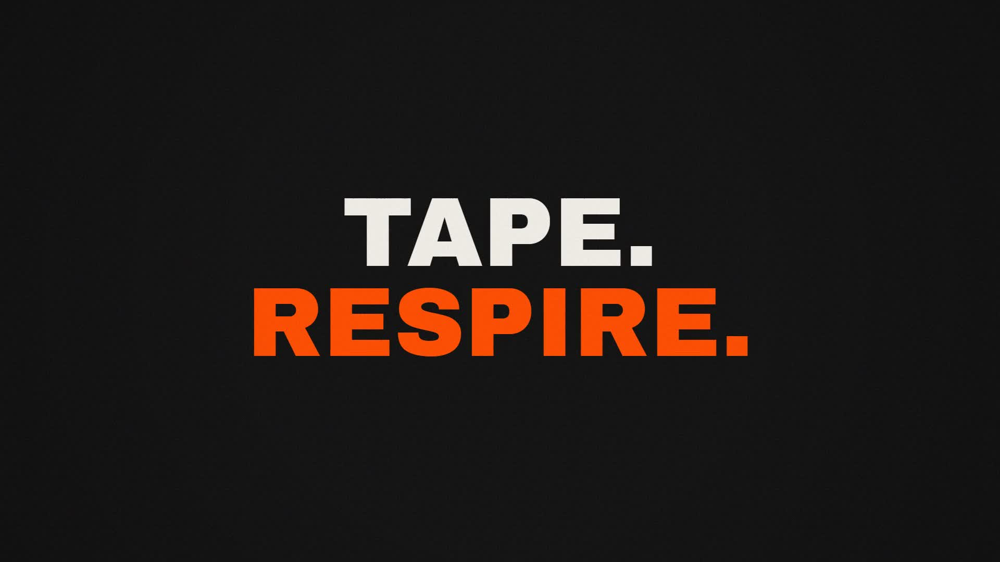
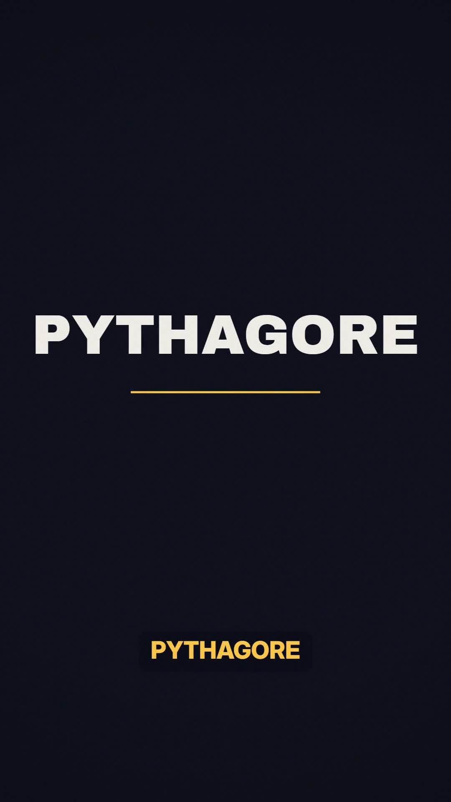
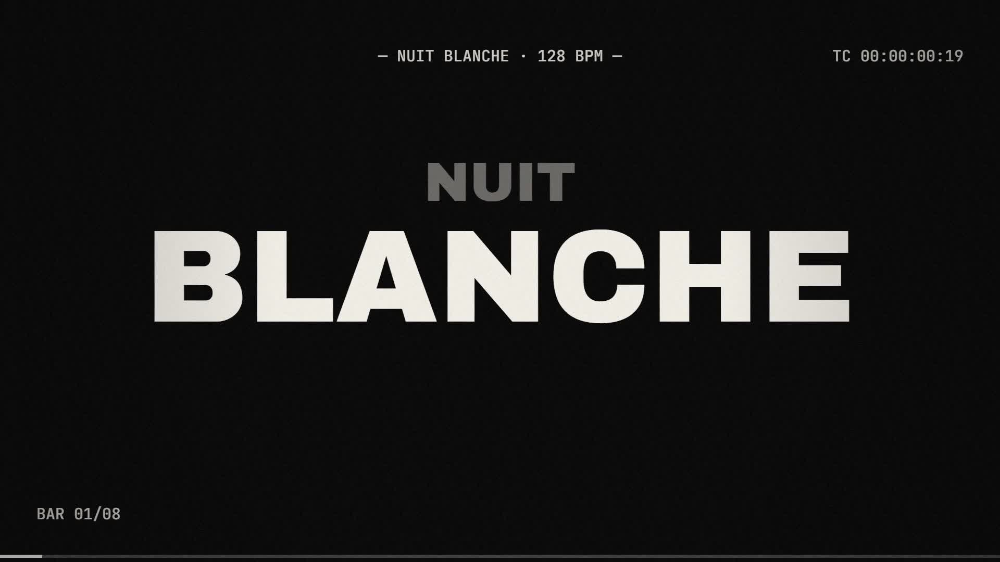

# Motion Video Skills 🎬

**Des vidéos complètes en code** — motion design, explainers narrés, lyric videos beat-synced,
shorts faceless, animations 3D — rendues en MP4 avec musique/voix off synchronisées et
captions mot-par-mot. Pour Claude Code, ZCode, Cursor, Codex et tout agent qui lit des skills.

| Test ZEN (promo) | Test Pythagore (explainer 9:16) | Test Nuit Blanche (lyric 128 BPM) |
|---|---|---|
|  |  |  |

*Les 3 affiches ci-dessus sont des frames réelles extraites de vidéos générées et rendues
entièrement avec ce skill (voir [Validé en conditions réelles](#validé-en-conditions-réelles)).*

---

## Installation

### Option 1 — `npx skills` (skills.sh, recommandé)

```bash
npx skills add Ahmed-OC/motion-video-skills -g -s '*' -y          # les 3 skills, tu choisis l'agent
npx skills add Ahmed-OC/motion-video-skills -g -s '*' -a '*' -y   # les 3 skills, TOUS les agents détectés
npx skills add Ahmed-OC/motion-video-skills -g -s motion-video -y # seulement le skill principal
```

Installe en canonique dans `~/.agents/skills/` puis symlink vers chaque agent trouvé
(Claude Code, Cursor, Codex, Cline, Amp, Augment…). Met à jour plus tard avec
`npx skills update`. **Nécessite Node ≥ 22** — sinon, option 2 ou 3.

### Option 2 — curl (une ligne, n'importe quel shell, n'importe quel Node)

```bash
curl -fsSL https://raw.githubusercontent.com/Ahmed-OC/motion-video-skills/main/install.sh | bash
```

Met les 3 skills en place dans `~/.agents/skills/` (idempotent : re-lancer = mise à jour).
Variantes :
```bash
curl -fsSL https://raw.githubusercontent.com/Ahmed-OC/motion-video-skills/main/install.sh | bash -s -- ~/.claude/skills
curl -fsSL https://raw.githubusercontent.com/Ahmed-OC/motion-video-skills/main/install.sh | bash -s -- ./.agents/skills   # projet courant
```

### Option 3 — git clone (manuel)

```bash
git clone --depth 1 https://github.com/Ahmed-OC/motion-video-skills /tmp/mvs \
  && mkdir -p ~/.agents/skills \
  && cp -r /tmp/mvs/skills/* ~/.agents/skills/ \
  && rm -rf /tmp/mvs
```

> `~/.agents/skills/` est l'emplacement standard multi-outils, lu nativement par ZCode et
> la plupart des agents ; pour un seul projet, utilisez `<projet>/.agents/skills/`.

**Prérequis du pipeline de rendu** (le skill affiche les commandes exactes si absent) :
```bash
node -v                          # ≥ 18
npm i -D playwright && npx playwright install chromium
ffmpeg -version                  # sinon : winget install Gyan.FFmpeg (Win) / brew install ffmpeg (mac)
pip install edge-tts             # optionnel — voix off gratuite
```

<details><summary>Installer uniquement les skills enfants</summary>

```bash
npx skills add Ahmed-OC/motion-video-skills -g -s video-qa -s tts-voiceover -y
# ou via curl : l'installeur copie tout — supprime simplement le dossier non voulu :
#   rm -rf ~/.agents/skills/motion-video
```
</details>

---

## 🥇 Skill principal — `motion-video`

**Le point d'entrée.** Il produit une vidéo complète, de l'idée au MP4 vérifié. Ne s'installe
jamais sans lui (les enfants sont des options).

| | |
|---|---|
| **Ce qu'il fait** | Brief structuré → timeline JSON (source de vérité unique) → style gate sur stills → animation déterministe (`seek(t)`, fonction pure du temps) → musique synthétisée sur grille BPM → rendu headless → vérification (probe + planche contact + critique) → livraison MP4 −14 LUFS |
| **Moteurs routés** | Canvas vanilla (défaut) · Remotion (React/data-viz) · HyperFrames (Apache-2.0) · Manim CE (maths) · Blender headless (3D) |
| **Les 10 non-négociables** | Frames pures de `t` · une seule timeline.json · jamais d'easing linéaire · entrées multi-propriétés stagger 3-6 frames · sorties plus rapides · frame math explicite · un changement visuel toutes les 2-4 s · blacklist anti-slop · stems séparés duckés −14 LUFS · jamais livré sans avoir vu le rendu |
| **Contenu** | 5 références (engines, motion-craft, story-pipelines, audio, verify) · 4 scripts (`render_frames.mjs` : rendu Playwright→ffmpeg ; `contact_sheet.sh` ; `probe.sh` ; `beat_grid.py`) · 2 assets (starter canvas complet avec synthé intégré, schéma JSON de timeline) |

```text
skills/motion-video/
├── SKILL.md                      # boucle de production en 9 étapes + routing
├── references/  engines · motion-craft · story-pipelines · audio · verify
├── scripts/     render_frames.mjs · contact_sheet.sh · probe.sh · beat_grid.py
└── assets/      seek-template.html (starter autonome) · timeline.schema.json
```

Usage typique : *« Fais-moi une vidéo motion design de 15s, style Swiss brutaliste, avec
musique »* → le skill déroule intake → brief → timeline → stills d'approbation → build →
synth audio → rendu → vérification → livraison.

---

## 🧩 Skills enfants (optionnels, dans `skills/`)

### `video-qa` — le portail qualité vidéo
Audit et finition de **n'importe quelle** vidéo (générée ou pas, MP4/WebM/MOV) :
probe des specs vs attendu, mesure + normalisation −14 LUFS (réencodage audio seul),
planches contact et bandes de frames, rubrique de critique notée /10, tests de
déterminisme (framemd5), checklist de livraison. Déclencheurs : « vérifie/normalise/
prépare ma vidéo », « elle rend bizarre, diagnostique ».

### `tts-voiceover` — voix off avec timings mot-par-mot
Génère narration + timings sans pipeline vidéo complet : `edge-tts` gratuit multi-langue
(par défaut), Kokoro/Piper locaux, ElevenLabs ; fallback whisper pour caler les mots sur
n'importe quel audio. Sorties prêtes à l'emploi : `vo.mp3`, pages de captions 1-3 mots avec
fenêtres par mot, `vo.js` intégrable. Déclencheurs : « voix off », « TTS », « sous-titres
synchronisés au mot ». Encode les pièges appris en test (edge-tts v7 `boundary=`
obligatoire, 403 → upgrade).

---

## Validé en conditions réelles

Trois vidéos générées de bout en bout avec le skill (affiches en haut) :

| Test | Résultat | Ce que la boucle a attrapé |
|---|---|---|
| **Promo app méditation** — 14,4 s, 1920×1080, 100 BPM, musique 100 % code | −14.0 LUFS, rendu 57 s | label trop petit, soulignement CTA trop court |
| **Explainer Pythagore** — 29 s, 9:16, VO française edge-tts + captions mot-par-mot | −14.3 LUFS, rendu 82 s | labels en collision avec les points, équation mal espacée, captions en zone UI TikTok, offset du label « c=5 » inversé |
| **Lyric video N&B** — 15 s, 128 BPM, drop avec 0,12 s de silence | −14.5 LUFS, rendu 60 s | RGB split trop discret, ghosts trop faibles |

…et **un faux positif neutralisé** : un critique visuel affirmait un titre clippé ;
`measureText()` a prouvé 76 px de marge. D'où la règle du skill : *toute réclamation de
défaut géométrique se vérifie par mesure avant correction*. Trois bugs réels découverts en
test ont été corrigés dans les scripts livrés ici (types parseArgs, syntaxe tile ffmpeg 7+,
passe loudnorm documentée).

## Crédits & sources

Distillé d'une recherche multi-langue (EN/JP/ZH/ES/FR/KO…) sur les pipelines vidéo-en-code
2025-2026 : skills officielles [Remotion](https://remotion.dev/docs/ai/skills),
[HyperFrames](https://github.com/heygen-com/hyperframes), packs
[iart-ai](https://github.com/iart-ai/motion-skills),
[cth9191/animate](https://github.com/cth9191/animate),
[awesome-claude-video-skills](https://github.com/zhuyansen/awesome-claude-video-skills),
et des dizaines de retours Reddit/X/Zenn/Zhihu — synthétisés en un pipeline cohérent.

## Licence

[MIT](LICENSE) © 2026 Ahmed-OC — les polices citées (Archivo Black, Inter, JetBrains Mono)
restent sous leurs licences respectives (OFL).
