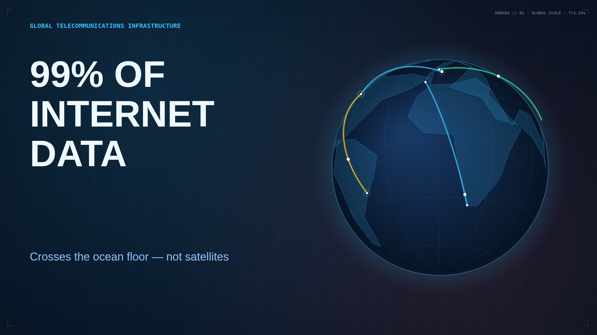
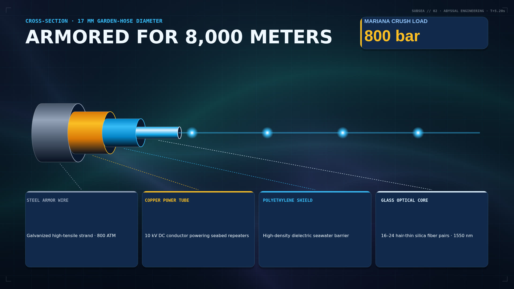
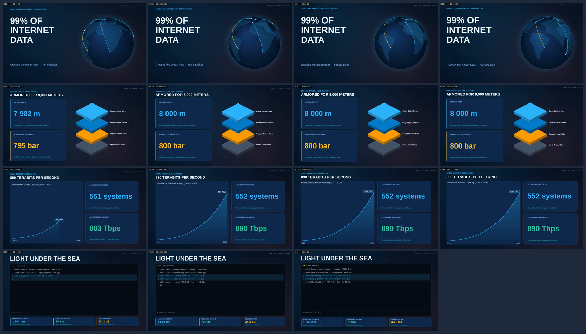

# motion-video-skills v2.0

Universal studio-grade **Video-as-Code** agent skills (`frame = f(t)`) — engineered so **both Frontier models AND fast/smaller models** (e.g. `gemini-3.8-flash`, `gemini-2.5-flash`, `Haiku`, `DeepSeek-Flash`, `Qwen-Coder`) produce broadcast-ready, collision-free, **BT.709 / −14 LUFS** MP4 videos across all 10 motion genres.

| `gemini-3.8-flash` + v2.0 (`Track S` + 2 Compiler Passes) | Frontier Studio (`Track F` Bespoke WebGL2 + 3D Cutaway) |
|---|---|
|  |  |



---

## Install

### Option 1 — `skills` CLI ([skills.sh](https://skills.sh))

```bash
npx skills add Ahmed-OC/motion-video-skills
```

### Option 2 — `curl | bash` (Zero Node / Hermes / Claude Code / Cursor / Codex / ZCode)

```bash
curl -fsSL https://raw.githubusercontent.com/Ahmed-OC/motion-video-skills/main/install.sh | bash
# Or install into a custom directory (e.g. Hermes Agent):
curl -fsSL https://raw.githubusercontent.com/Ahmed-OC/motion-video-skills/main/install.sh | bash -s -- ~/.hermes/skills
```

Installs **three composable skills**:

| Skill | Role in v2.0 |
|---|---|
| **`motion-video`** | End-to-end deterministic generator (`window.seek(t)`), **10-genre router**, **`motion-kit.js` (`window.MVS`)** auto-layout/spring/OKLCH/chart/globe/2.5D/shader SDK, **`fetch_assets.mjs`** zero-key vector downloader, parallel multi-worker **BT.709** `render_frames.mjs`. |
| **`video-qa`** | **`audit_telemetry.mjs`** (`< 2.5s` headless Chromium visual & geometric compiler with `LOCKED CLEAN SCENES` anti-regression guard), `disco.mjs` temporal cut/freeze audit, `post.mjs` 2-pass linear **−14 LUFS** + BT.709 VUI tagger, and VLM-grounded `contact_sheet.sh`. |
| **`tts-voiceover`** | VO-first multi-scene narration (`--scenes-json`), smart **FR / EN / CJK** 3-pass caption segmenter (French elisions `l'océan`, narrow non-breaking spaces, Kinsoku, zero orphan proclitics), and per-frame `[rms, bass, high]` audio envelopes (`vo_gen.py`). |

---

## Why v2.0? Closing the Small-Model vs Frontier Gap

Controlled empirical benchmark on the exact same 4-scene, 15s, 1080p@30fps tech/science brief (*"THE SUBSEA INTERNET"* — globe + 4-layer subsea cable anatomy + 2014–2026 Tbps chart + EDFA optical repeater code):

| Metric | `gemini-3.8-flash` + v1.0 | `gemini-3.8-flash` + v2.0 (`Track S`, 2 passes) | Frontier + v2.0 (`Track F`) |
|---|---|---|---|
| **Pre-render Telemetry (`audit_telemetry.mjs`)** | `88/100` (**FAIL**: text collision + 3 safe-zone breaches) | **Iter 1**: `84/100` (3 beam crossings caught in `2.7s`) → **Iter 2**: **`100/100` (`0` blockers)** | **`100/100` (`0` blockers)** |
| **Fresh-Page Determinism (`stills.mjs --determinism`)** | PASS | **PASS** (100% SHA-256 identical) | **PASS** (100% SHA-256 identical w/ WebGL2) |
| **Audio Stem & Mastering (`post.mjs`)** | **SILENT** (`Blob` return bug dropped audio) | **48 kHz Stereo AAC · −14.3 LUFS / −1.5 dBTP** | **48 kHz Stereo AAC · −14.3 LUFS / −1.5 dBTP** |
| **Temporal Continuity (`disco.mjs`)** | **2.27s dead freeze** (`4.77s → 7.00s`) | **0 spikes · 0 freezes (`PASS`)** | **0 spikes · 0 freezes (`PASS`)** |
| **Visual Architecture** | Flat circles on `#050B14` void + duplicate captions | 3D continental globe + 2.5D exploded stack + scrub chart + IDE card | WebGL2 aurora shader + 3D cutaway cylinder + IDE card |

See [`docs/BENCHMARK_AND_ARCHITECTURE_V2.md`](docs/BENCHMARK_AND_ARCHITECTURE_V2.md) for the full methodology, SOTA research synthesis (US, China `#Vibe知识大赏` / `VibeVideoBench`, Japan *Moji-PV* *Kire/Yoin*, Korea Hangul), and mathematical fixes.

---

## What Ships in v2.0

### 1. `window.MVS` (`skills/motion-video/assets/motion-kit.js`)
Zero-dependency studio runtime + automatic Canvas/DOM telemetry (`__MVS_TELEMETRY__`):
- **3-Regime Exact Analytical Springs**: Underdamped (`ζ < 1`), critical (`ζ = 1`), and overdamped (`ζ > 1`) clamped on **total mechanical energy** (never `NaN` at `ζ >= 1`, never freezes mid-flight at `x = 1`), Apple perceptual `(duration, bounce)` parameterization, $C^1$ additive retargeting, Newton-Raphson `cubicBezier`, *Kire/Tame-Tsume* easings, golden-ratio `idleNoise`, and logarithmic `expZoom`.
- **Perceptual Color Science (`OKLCH`)**: Ottosson OKLCH converter & mixer (zero muddy gray gradients), hue-shifted Kurzgesagt shadow/highlight pairs, and 8 curated studio themes (`linear-dark`, `swiss-brutalist`, `paperclip-cn`, `cyber-fui-jp`, `kurzgesagt-pop`, `riso-editorial`, `deep-ocean-atlas`, `apple-keynote`).
- **Collision-Free Auto-Layout & CJK-Safe Typography**: `computeSafeZone` (16:9 broadcast + 2026 9:16 TikTok/Reels/Shorts L-shaped UI envelope), `vstack`, `hstack`, `bentoGrid`, and 7-step binary-searched `drawTextAutoFit` with balanced line wrapping and *Kinsoku* rules.
- **10 Genre Visual Primitives**: `drawGlobeWire` (with continental silhouettes + 3D great-circle slerp arcs), `drawIsometricStack` (`等轴测沙盘`), `drawFlowBeam` (`流光`), `drawAreaChart`, `drawBarChart`, `drawMetricCard`, `drawCodeCard`, `drawActor`, `createShaderBackdrop` (WebGL2 Stripe mesh, gyroid aurora, `fwidth` grid), and `synthStudioAudio` (Paul Kellet pink noise + neo-soul chords + `-4.5 dB` vocal-formant carve).

### 2. `< 2.5s` Pre-Render Visual Compiler (`skills/video-qa/scripts/audit_telemetry.mjs`)
Sweeps ~75 stratified timestamps in headless Chromium memory **before encoding MP4**:
- Traps silent `NaN`/`Infinity` Canvas arguments, pairwise AABB text/card collisions (computing exact `+Δy` Minimum Separation Vectors), `BEAM_CROSSES_CONTENT` line intersections, real pixel-ring WCAG contrast (solving the exact `#HEX` for `5.5:1`), 2026 safe-zone breaches, blank/sparse "black void" frames, static holds, and duplicate captions.
- Outputs `🔒 LOCKED CLEAN SCENES` so iterative repairs by smaller models never regress scenes that already passed.

### 3. Zero-Key Vector Asset Fetcher (`skills/motion-video/scripts/fetch_assets.mjs`)
Downloads deterministic local SVGs/TopoJSON with **zero API keys**: Iconify (200k Lucide/Phosphor/Solar icons), SVGL & Simple Icons brand logos, palette-recolored unDraw vector scenes, DiceBear CC0 characters (`open-peeps`, `notionists`), and Natural Earth `countries-110m.json`.

---

## Runtime Prerequisites

 Only needed when rendering frames/audio locally:

```bash
node --version                                    # ≥ 18
npm i -D playwright && npx playwright install chromium   # or global playwright-core + ms-playwright cache
ffmpeg -version                                   # H.264 +BT.709 + EBU R128 loudnorm
pip install -U edge-tts                           # optional: free neural voiceover + word timings
```

## License

MIT
