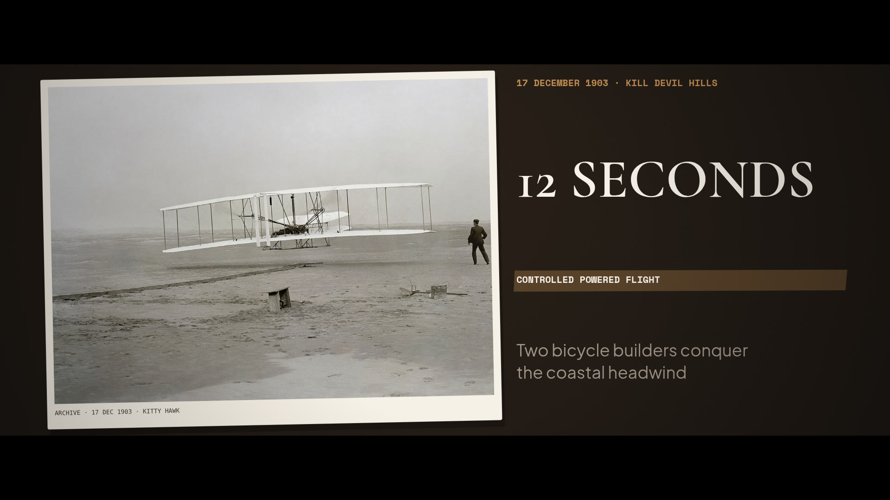
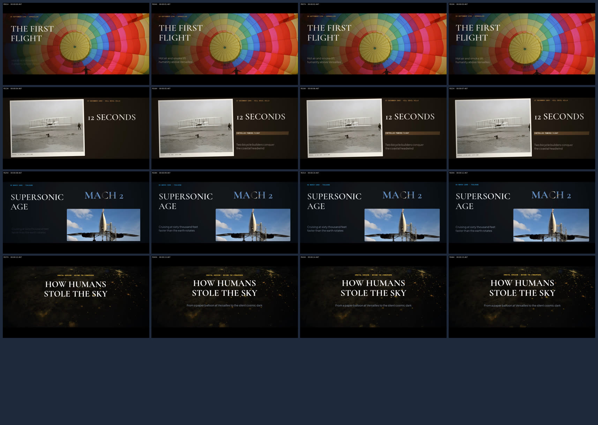

# motion-video-skills v3.0 — Universal Creative Studio

Deterministic **Video-as-Code** (`frame = f(t)`) studio suite engineered so **both Frontier models AND fast/smaller models** (`gemini-3.8-flash`, `Haiku`, `DeepSeek-Flash`, `Qwen-Coder`) produce **human-studio-grade BT.709 / −14 LUFS MP4 films** across **every video universe** — **without ever looking AI-generated**:
- **2.39:1 Cinema & Historical Documentary** (*A24, Vox, Arte, Ken Burns* — real HD archives, 35mm grain, Editorial Serif, J-cut strings, zero UI boxes)
- **Photorealistic 3D PBR & Hybrid HD Cinema** (*Three.js AgX + PolyHaven HDRIs, Headless Blender 4.x Cycles, deterministic FFmpeg video-frame sequences*)
- **Luxury Editorial, Emotional Storytelling & Kinetic Manifestos** (*85% restraint / 15% signature gesture, Emotional Color Scripts, Ma negative space*)
- **SaaS Product Launches, 2.5D Tech Architecture, Data Journalism, STEM & 9:16 Social Shorts**

| `gemini-3.8-flash` + v3.0 (`2.39:1` Archival Cinema — *Zero UI Cards!*) | `gemini-3.8-flash` + v3.0 (2.5D Tech & Master Montage) |
|---|---|
|  |  |



---

## Install

```bash
npx skills add Ahmed-OC/motion-video-skills
# Or universal curl installer (Hermes Agent / Claude Code / Cursor / Codex / ZCode):
curl -fsSL https://raw.githubusercontent.com/Ahmed-OC/motion-video-skills/main/install.sh | bash
```

Installs **three composable skills**:

| Skill | Role in v3.0 |
|---|---|
| **`motion-video`** | **Phase-0 Creative Director Protocol** (asks via `clarify` when interactive, or self-authors `creativeDirection` autonomously), **Multi-Universe Router**, **`motion-kit.js` v3.0 (`window.MVS`)**, **`fetch_assets.mjs` v3.0** (Wikimedia HD, NASA HD, Met Museum CC0, PolyHaven 3D HDRI/PBR, FFmpeg frame sequences, icons/logos), and parallel **BT.709** `render_frames.mjs`. |
| **`video-qa`** | **`audit_telemetry.mjs` v3.0** (`< 3s` 17-gate context-aware visual, temporal, montage & anti-cliché compiler with `LOCKED CLEAN SCENES`), `disco.mjs`, `post.mjs` (**−14 LUFS** + BT.709 VUI), and `contact_sheet.sh`. |
| **`tts-voiceover`** | VO-first multi-scene narration (`--scenes-json`), **FR / EN / CJK** smart 3-pass caption segmenter, and per-frame `[rms, bass, high]` audio envelopes (`vo_gen.py`). |

---

## What Makes v3.0 Never Look "AI-Generated"

1. **Mandatory Phase-0 Creative Director Thinking (`creativeDirection`)**:
   - When interactive and the prompt is open, the agent asks 3–4 sharp creative questions first.
   - When autonomous, the agent **must ask those 5 questions to itself** inside `timeline.json -> creativeDirection` (`universe`, `emotionalArc`, `visualMetaphor`, `typographyPairing`, `signatureMoment` obeying the **85% restraint / 15% audacity law**, and `forbiddenCliches`) *before* coding scenes.
2. **`Physics Strict, Aesthetics Plural` (`motion-kit.js` v3.0)**:
   - **Strict Invisible Laws**: 3-regime analytical springs (zero `NaN`), OKLCH color mixing, collision-free `shotLayout` (6 topologies), 8 motivated transitions, 3-act intra-scene camera focus (`withCameraFocus` lens-clipped), and CJK-safe binary-searched typography.
   - **Plural Visible Worlds**: 14 themes (`cinema-a24`, `documentary-vox`, `luxury-editorial`, `warm-story`, `noir-chiaroscuro`, `sakura-anime`, `swiss-brutalist`, `paperclip-cn`, `linear-dark`, etc.), **12 Google Fonts pairings** (`loadGoogleFonts`), **per-scene Emotional Color Scripts**, `drawImagePlate` (`full-bleed` chiaroscuro, tilted museum `archival-plate`, `knockout-type` photo-masked letters), `drawHighlighter`, **35mm film grain + halation + `2.39:1` letterbox** (`applyCinemaOptics`), and **J-Cut bowed cinema strings / felt piano** (`synthCinemaScore`).
3. **17-Gate Context-Aware Compiler (`audit_telemetry.mjs` v3.0)**:
   - Catches AABB overlaps (`+Δy px`), beam crossings, WCAG contrast, safe-zones, frozen holds, `SHOT_POLARITY_MONOTONY`, `TRANSITION_MONOTONY`, `EYE_TRACE_WHIPLASH`, and `OFF_BEAT_CUT` — while **respecting intentional *Ma* minimalism** on Cinema/Luxury frames and blocking SaaS UI cards/HUD inside non-tech films via **`CLICHE_VIOLATION`**!
4. **Zero-Key Multi-Universe Asset Fetcher (`fetch_assets.mjs` v3.0)**:
   - Real HD historical/documentary photos (`--wikimedia`), NASA space/Earth plates (`--nasa`), Metropolitan Museum CC0 fine art (`--art`), PolyHaven CC0 2K `.hdr` lighting & PBR maps (`--polyhaven-hdri`, `--polyhaven-tex`), deterministic video frame extraction (`--extract-video`), plus Iconify, SVGL, unDraw, DiceBear, Natural Earth, and zero-CORS `--bundle`!

## License

MIT
